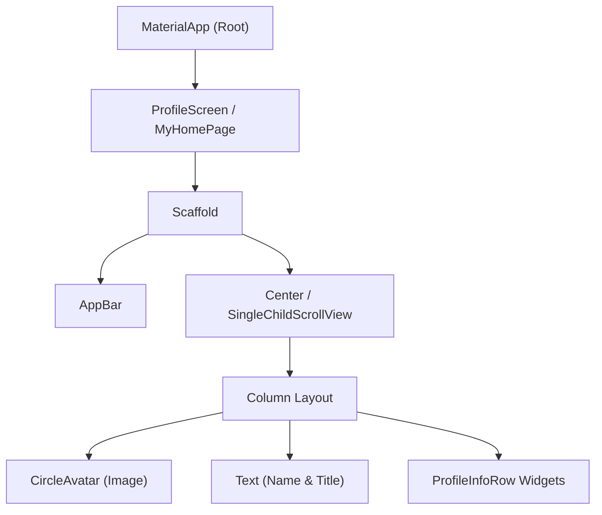

# Mobile Application Development (MAD) • Lab Report 01
## Flutter Fundamentals, Basic State, & Profile Screen UI

---

### 📋 Student Information
- **Student Name:** Maaz Ali
- **Roll Number:** 3143
- **Degree Program:** Bachelor of Science in Computer Science (BSCS)
- **Semester:** 8th Semester
- **Course:** Mobile Application Development (MAD)
- **Lab Date:** September 12, 2026

---

## 1. 🎯 Lab Objectives
1. Understand the core architecture of Flutter, including the Widget tree, `StatelessWidget`, and `StatefulWidget`.
2. Master basic reactive UI state manipulation using `setState()`.
3. Construct interactive layouts with buttons (`FloatingActionButton`, `ElevatedButton`), icons, custom typography, and styling.
4. Implement a production-grade, visually appealing **Profile Screen** combining circular avatars, custom cards, inline icons, and responsive scrolling.

---

## 2. 🧠 Theoretical Background & Key Concepts

### 2.1 The Flutter Widget Tree
In Flutter, everything is a widget. The UI is built by composing widgets hierarchically.
- **`StatelessWidget`**: Immutable widgets whose properties cannot change at runtime (e.g., `Text`, `Icon`, `CircleAvatar`).
- **`StatefulWidget`**: Widgets that maintain mutable state across their lifecycle. Calling `setState()` notifies the Flutter framework to rebuild the widget subtree.



### 2.2 Core Layout Widgets Used
- `Scaffold`: Provides the standard material design visual structure (AppBar, Body, FloatingActionButton).
- `Column` / `Row`: Linear layout models along vertical and horizontal axes.
- `SingleChildScrollView`: Prevents UI overflow issues on small screen viewports.
- `CircleAvatar` & `BoxDecoration`: Implements rounded avatar presentation with drop shadows.

---

## 3. 📂 Projects in this Lab

| Project Directory | Description | Primary Widgets Used |
|---|---|---|
| `my_first_app/` | Interactive Counter application with increment, decrement, and reset operations | `StatefulWidget`, `Column`, `FloatingActionButton`, `ThemeData` |
| `profile_screen/` | Polished personal profile page displaying developer information | `StatelessWidget`, `CircleAvatar`, `TextSpan`, `BoxDecoration`, `Divider` |

---

## 4. 💻 Implementation Details & Code Breakdown

### 4.1 Counter Application (`my_first_app/lib/main.dart`)
The counter app demonstrates mutable state tracking:
```dart
class _MyHomePageState extends State<MyHomePage> {
  int _counter = 0;

  void _incrementCounter() => setState(() => _counter++);
  void _decrementCounter() => setState(() => _counter--);
  void _resetCounter() => setState(() => _counter = 0);
  
  // UI rendering with FloatingActionButtons...
}
```

### 4.2 Profile Screen UI (`profile_screen/lib/main.dart`)
Modular `ProfileInfoRow` custom widget for clean reusability:
```dart
class ProfileInfoRow extends StatelessWidget {
  final IconData icon;
  final String label;
  final String value;

  const ProfileInfoRow({
    super.key,
    required this.icon,
    required this.label,
    required this.value,
  });

  @override
  Widget build(BuildContext context) {
    final primary = Theme.of(context).colorScheme.primary;
    return Padding(
      padding: const EdgeInsets.symmetric(vertical: 10),
      child: Row(
        mainAxisSize: MainAxisSize.min,
        children: [
          Container(
            padding: const EdgeInsets.all(8),
            decoration: BoxDecoration(
              color: primary.withOpacity(0.1),
              shape: BoxShape.circle,
            ),
            child: Icon(icon, size: 16, color: primary),
          ),
          const SizedBox(width: 10),
          Text.rich(
            TextSpan(
              children: [
                TextSpan(
                  text: '$label: ',
                  style: TextStyle(fontSize: 14, color: Colors.grey.shade600, fontWeight: FontWeight.w500),
                ),
                TextSpan(
                  text: value,
                  style: const TextStyle(fontSize: 14.5, fontWeight: FontWeight.w700, color: Colors.black87),
                ),
              ],
            ),
          ),
        ],
      ),
    );
  }
}
```

---

## 5. 🚀 Execution & Verification Guide

### Running `my_first_app`:
```bash
cd "MAD BSCS 8TH SEMESTER/Lab 01 - Flutter Fundamentals & Profile UI/my_first_app"
flutter pub get
flutter run -d linux # Or -d chrome
```

### Running `profile_screen`:
```bash
cd "MAD BSCS 8TH SEMESTER/Lab 01 - Flutter Fundamentals & Profile UI/profile_screen"
flutter pub get
flutter run -d linux # Or -d chrome
```

---

## 6. 🏁 Lab Conclusion
In this lab, foundational Flutter skills were established. We created responsive UI layouts, managed component lifecycles, practiced widget decomposition, and applied material design guidelines with custom themes.
