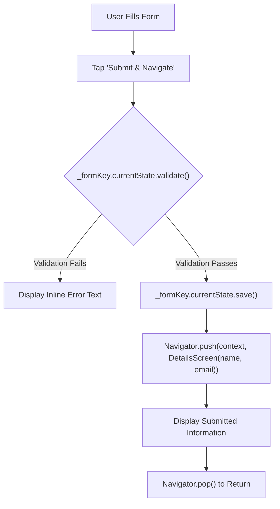

# Mobile Application Development (MAD) • Lab Report 02
## Touch Gestures, Form Validation, & Screen Navigation

---

### 📋 Student Information
- **Student Name:** Maaz Ali
- **Roll Number:** 3143
- **Degree Program:** Bachelor of Science in Computer Science (BSCS)
- **Semester:** 8th Semester
- **Course:** Mobile Application Development (MAD)
- **Lab Date:** September 18, 2026

---

## 1. 🎯 Lab Objectives
1. Understand and handle mobile touch events and user interaction using Flutter's `GestureDetector`.
2. Build interactive forms with `Form`, `TextFormField`, and `GlobalKey<FormState>`.
3. Implement robust client-side validation rules (empty check, RegExp email validation).
4. Perform explicit multi-screen navigation and pass validated form data using `Navigator.push()` and `MaterialPageRoute`.

---

## 2. 🧠 Theoretical Background & Key Concepts

### 2.1 Touch Gesture Detection (`GestureDetector`)
Flutter does not have separate click listeners on generic containers. Instead, `GestureDetector` recognizes multi-touch gestures:
- `onTap`: Single short click.
- `onDoubleTap`: Consecutive taps within a small threshold.
- `onLongPress`: Sustained touch contact.

### 2.2 Form Management & Validation Flow


---

## 3. 📂 Projects in this Lab

| Project Directory | Description | Primary Widgets Used |
|---|---|---|
| `gesture_detector_example/` | Interactive color box responding to single tap (Red), double tap (Yellow), and long press (Green) | `GestureDetector`, `AnimatedContainer`, `StatefulWidget` |
| `form_example/` | Form with name and email validation, transferring data to a secondary confirmation screen | `Form`, `TextFormField`, `RegExp`, `Navigator.push`, `Navigator.pop` |

---

## 4. 💻 Source Code Highlights

### 4.1 Touch Gesture Handling (`gesture_detector_example/lib/main.dart`)
```dart
GestureDetector(
  onTap: () {
    setState(() {
      _color = Colors.red;
      _eventText = "Box is red: you single-tapped";
    });
  },
  onDoubleTap: () {
    setState(() {
      _color = Colors.yellow;
      _eventText = "Box is yellow: you double-tapped";
    });
  },
  onLongPress: () {
    setState(() {
      _color = Colors.green;
      _eventText = "Box is green: you long-pressed";
    });
  },
  child: Container(
    height: 200,
    width: 200,
    decoration: BoxDecoration(
      color: _color,
      borderRadius: BorderRadius.circular(16),
    ),
  ),
)
```

### 4.2 Form Validation & Navigation (`form_example/lib/main.dart`)
```dart
ElevatedButton(
  onPressed: () {
    if (_formKey.currentState!.validate()) {
      _formKey.currentState!.save();

      // Navigate to the DetailsScreen and pass data
      Navigator.push(
        context,
        MaterialPageRoute(
          builder: (context) => DetailsScreen(
            name: _name,
            email: _email,
          ),
        ),
      );
    }
  },
  child: const Text("Submit & Navigate"),
)
```

---

## 5. 🚀 Execution & Verification Guide

### Running `gesture_detector_example`:
```bash
cd "MAD BSCS 8TH SEMESTER/Lab 02 - Gestures & Form Validation/gesture_detector_example"
flutter pub get
flutter run -d linux # Or -d chrome
```

### Running `form_example`:
```bash
cd "MAD BSCS 8TH SEMESTER/Lab 02 - Gestures & Form Validation/form_example"
flutter pub get
flutter run -d linux # Or -d chrome
```

---

## 6. 🏁 Lab Conclusion
This lab successfully taught gesture manipulation, input handling, custom regular expressions for email validation, and clean navigation between application routes in Flutter.
