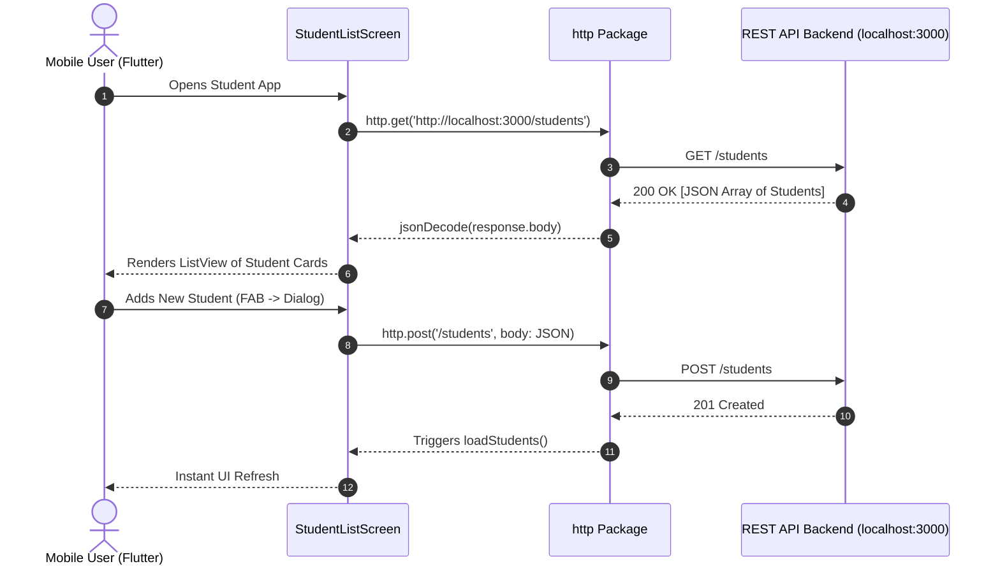

# Mobile Application Development (MAD) • Lab Report 03
## Navigation, Dynamic Lists/Grids, & HTTP REST API Client

---

### 📋 Student Information
- **Student Name:** Maaz Ali
- **Roll Number:** 3143
- **Degree Program:** Bachelor of Science in Computer Science (BSCS)
- **Semester:** 8th Semester
- **Course:** Mobile Application Development (MAD)
- **Lab Date:** September 25, 2026

---

## 1. 🎯 Lab Objectives
1. Implement named route navigation using Flutter's `MaterialApp(routes: {...})`.
2. Construct high-performance dynamic collections using `ListView.builder` and `GridView.builder`.
3. Integrate network requests using the `http` package for full CRUD (Create, Read, Update, Delete) against a RESTful API endpoint.
4. Handle asynchronous UI updates using `FutureBuilder` with loading indicators and error states.

---

## 2. 🧠 Theoretical Background & Architecture

### 2.1 Named Route Architecture
Named routes map string identifiers (e.g. `'/'`, `'/gridview'`) to widget builders, enabling decoupled navigation across complex screen hierarchies.

### 2.2 Asynchronous REST Client Data Flow


---

## 3. 📂 Projects in this Lab

| Project Directory | Description | Key Modules / Widgets |
|---|---|---|
| `nav_list_view_and_grid_view/` | Demonstration of ListView with icons/subtitles and dynamic multi-column GridView with named routes | `ListView.builder`, `GridView.builder`, `Navigator.pushNamed` |
| `api_list_app/` | Full mobile client for student management performing GET, POST, PUT, DELETE operations | `http`, `FutureBuilder`, `AlertDialog`, `jsonDecode`, `jsonEncode` |

---

## 4. 💻 Source Code Highlights

### 4.1 REST API CRUD Operations (`api_list_app/lib/main.dart`)
```dart
const String apiBaseUrl = 'http://localhost:3000';

// READ: Fetch students list
Future<List<dynamic>> fetchStudents() async {
  final response = await http.get(Uri.parse('$apiBaseUrl/students'));
  if (response.statusCode == 200) {
    return jsonDecode(response.body);
  } else {
    throw Exception('Failed to load students');
  }
}

// CREATE: Add new student
Future<void> createStudent(String name, String email, String course) async {
  await http.post(
    Uri.parse('$apiBaseUrl/students'),
    headers: {'Content-Type': 'application/json; charset=UTF-8'},
    body: jsonEncode({'name': name, 'email': email, 'course': course}),
  );
  loadStudents();
}

// UPDATE: Modify existing student
Future<void> updateStudent(dynamic id, String name, String email, String course) async {
  await http.put(
    Uri.parse('$apiBaseUrl/students/$id'),
    headers: {'Content-Type': 'application/json; charset=UTF-8'},
    body: jsonEncode({'id': id, 'name': name, 'email': email, 'course': course}),
  );
  loadStudents();
}

// DELETE: Remove student
Future<void> deleteStudent(dynamic id) async {
  await http.delete(Uri.parse('$apiBaseUrl/students/$id'));
  loadStudents();
}
```

---

## 5. 🚀 Execution & Verification Guide

### Step 1: Start Backend REST API Server (see Lab 03 Backend)
```bash
cd "MAD BSCS 8TH SEMESTER/Lab 03 - REST API Backend Server"
npm start
```

### Step 2: Run Mobile Client App
```bash
cd "MAD BSCS 8TH SEMESTER/Lab 03 - Navigation Lists & REST API Client/api_list_app"
flutter pub get
flutter run -d chrome # Or -d linux
```

---

## 6. 🏁 Lab Conclusion
This lab achieved end-to-end integration between Flutter mobile clients and backend REST services, utilizing asynchronous programming (`async`/`await`), stateful list rendering, and material dialogs.
