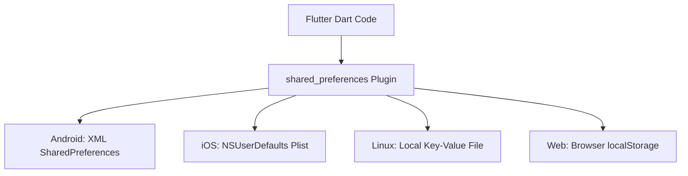

# Mobile Application Development (MAD) • Lab Report 05
## Local Persistence & Key-Value Storage using SharedPreferences

---

### 📋 Student Information
- **Student Name:** Maaz Ali
- **Roll Number:** 3143
- **Degree Program:** Bachelor of Science in Computer Science (BSCS)
- **Semester:** 8th Semester
- **Course:** Mobile Application Development (MAD)
- **Lab Date:** October 7, 2026

---

## 1. 🎯 Lab Objectives
1. Understand local data persistence mechanisms in mobile operating systems (Android `SharedPreferences`, iOS `NSUserDefaults`, Linux key-value store, Web `localStorage`).
2. Implement persistent theme preferences across application restarts.
3. Manage user authentication sessions, "Remember Me" toggles, and auto-login redirection.
4. Store and retrieve all primitive data types (`int`, `double`, `String`, `bool`) and clear disk caches via `prefs.clear()`.
5. Serialize and deserialize structured collections (To-Do list tasks) using `jsonEncode()` and `jsonDecode()`.

---

## 2. 🧠 Theoretical Background & Architecture

`SharedPreferences` wraps platform-specific persistent key-value storage APIs:



### Supported Data Types & API Methods:
- `setBool(key, value)` / `getBool(key)`
- `setString(key, value)` / `getString(key)`
- `setInt(key, value)` / `getInt(key)`
- `setDouble(key, value)` / `getDouble(key)`
- `setStringList(key, value)` / `getStringList(key)`
- `remove(key)` / `clear()`

---

## 3. 📂 Tasks Breakdown in this Lab

```
Lab 05 - SharedPreferences & Local Storage/
├── shared_preferences_tasks_hub/   <-- Full Interactive Multi-Task Hub Application
│   ├── lib/
│   │   ├── main.dart                       <-- Master Hub with Navigation Cards
│   │   └── tasks/
│   │       ├── task1_theme_mode.dart       <-- Task 1: Theme Switcher
│   │       ├── task2_login_session.dart    <-- Task 2: Login Session & Remember Me
│   │       ├── task3_user_profile_counter.dart <-- Task 3: Multi-Data & Counter
│   │       └── task4_todo_persistence.dart <-- Task 4: To-Do JSON Persistence
│   └── pubspec.yaml
│
├── Task_1_Theme_Preference/        <-- Standalone Single-File Task 1
├── Task_2_User_Login_Session/      <-- Standalone Single-File Task 2
├── Task_3_Multi_Data_Profile_Counter/ <-- Standalone Single-File Task 3
├── Task_4_Todo_Notes_JSON_List/    <-- Standalone Single-File Task 4
└── assets/                         <-- Documentation & Screenshots
```

---

## 4. 💻 Implementation Details & Code Breakdown

### 4.1 Task 1: Dark & Light Mode Theme Preference
```dart
Future<void> _loadThemePreference() async {
  final prefs = await SharedPreferences.getInstance();
  setState(() {
    _isDarkMode = prefs.getBool('is_dark_mode') ?? false;
  });
}

Future<void> _toggleTheme(bool value) async {
  final prefs = await SharedPreferences.getInstance();
  await prefs.setBool('is_dark_mode', value);
  setState(() {
    _isDarkMode = value;
  });
}
```

### 4.2 Task 2: User Login Session & Auto-Login
```dart
Future<void> _checkLoginStatus() async {
  final prefs = await SharedPreferences.getInstance();
  final isLoggedIn = prefs.getBool('is_logged_in') ?? false;
  final username = prefs.getString('saved_username') ?? '';

  if (isLoggedIn && mounted) {
    Navigator.pushReplacement(
      context,
      MaterialPageRoute(builder: (context) => HomeScreen(username: username)),
    );
  }
}
```

### 4.3 Task 3: Multi-Data Type Storage & Reset
```dart
Future<void> _saveAllData() async {
  final prefs = await SharedPreferences.getInstance();
  await prefs.setString('username', _nameController.text);
  await prefs.setInt('counter_val', _counter);
  await prefs.setDouble('volume_level', _volume);
  await prefs.setBool('notifications_enabled', _notifications);
}

Future<void> _clearAll() async {
  final prefs = await SharedPreferences.getInstance();
  await prefs.clear();
  _loadAllData();
}
```

### 4.4 Task 4: Persistent To-Do Notes List (JSON Serialization)
```dart
// Saving JSON List
Future<void> _saveTodos() async {
  final prefs = await SharedPreferences.getInstance();
  final jsonStringList = _todos.map((todo) => jsonEncode(todo.toJson())).toList();
  await prefs.setStringList('todo_items', jsonStringList);
}

// Loading JSON List
Future<void> _loadTodos() async {
  final prefs = await SharedPreferences.getInstance();
  final stringList = prefs.getStringList('todo_items') ?? [];
  setState(() {
    _todos = stringList.map((str) => TodoItem.fromJson(jsonDecode(str))).toList();
  });
}
```

---

## 5. 🚀 Execution & Verification Guide

### Running the Interactive Multi-Task Hub:
```bash
cd "MAD BSCS 8TH SEMESTER/Lab 05 - SharedPreferences & Local Storage/shared_preferences_tasks_hub"
flutter pub get
flutter run -d linux # Or -d chrome
```

---

## 6. 🏁 Lab Conclusion
This laboratory session successfully demonstrated end-to-end client-side data persistence. We implemented persistent theme states, secure session flags, diverse primitive storage, and complex JSON data structures using Flutter's `shared_preferences` plugin.
