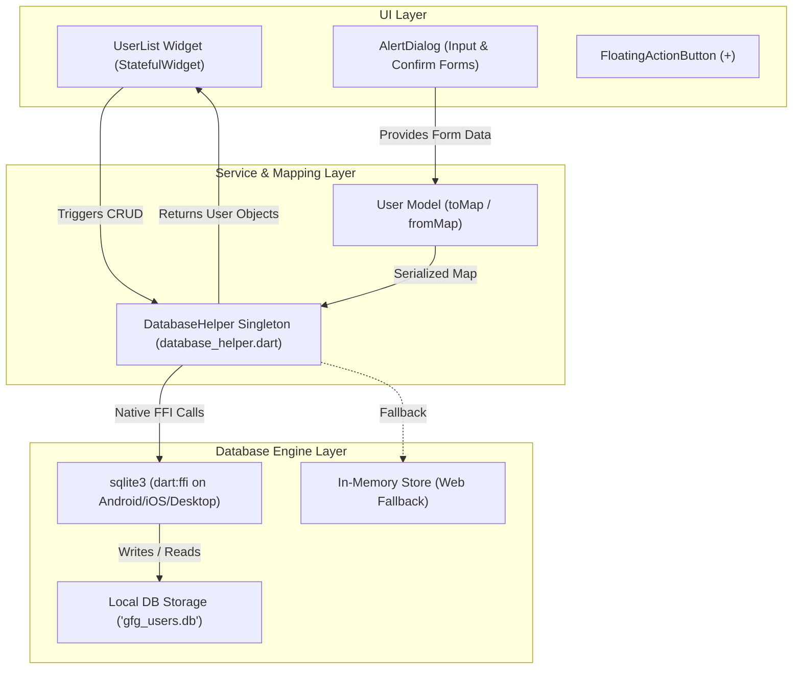
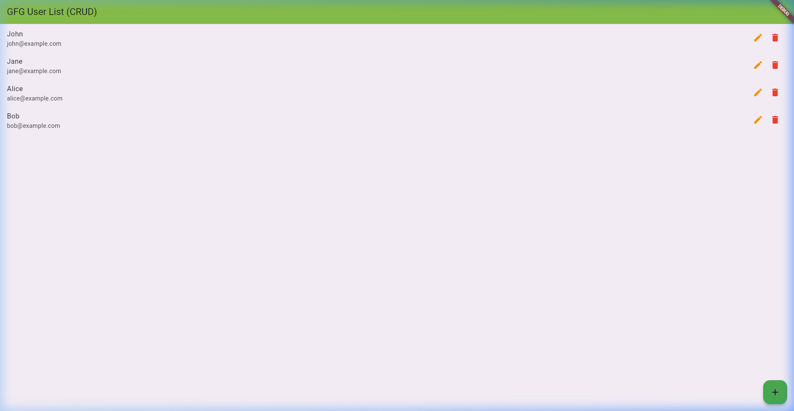
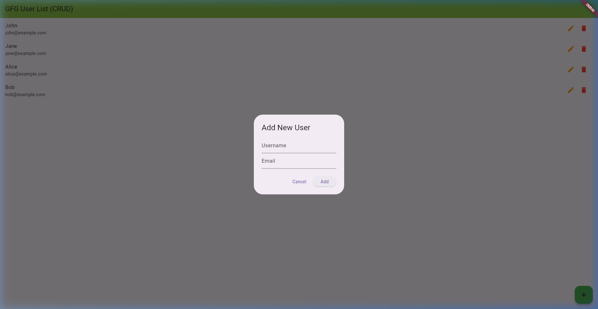

# Mobile Application Development (MAD) • Lab Report 06
## Local Relational Database & Full CRUD Operations using SQLite in Flutter

---

### 📋 Student Information
- **Student Name:** Maaz Ali
- **Roll Number:** 3143
- **Degree Program:** Bachelor of Science in Computer Science (BSCS)
- **Semester:** 8th Semester
- **Course:** Mobile Application Development (MAD)
- **Lab Date:** October 14, 2026

---

## 1. 🎯 Lab Objectives
1. Understand relational database persistence on mobile and cross-platform devices.
2. Implement an asynchronous Database Helper singleton (`DatabaseHelper.instance`) to manage SQLite database lifecycle (`open`, `create table`, `close`).
3. Model entities with two-way serialization: Dart Object ↔ SQLite Map (`toMap()`, `fromMap()`).
4. Execute complete **CRUD** operations:
   - **Create:** Insert new records with autoincrement primary keys.
   - **Read:** Query all records and map `ResultSet` rows to typed Dart objects.
   - **Update:** Modify existing records matching by ID.
   - **Delete:** Remove records safely with user confirmation dialogs.
5. Provide a responsive, clean user interface with `AlertDialog` input forms and `ListView.builder`.

---

## 2. 🧠 Theoretical Background & Architecture

SQLite is an in-process, serverless, self-contained relational SQL database engine embedded directly into mobile platforms (Android, iOS, Linux, Windows, macOS).



---

## 3. 📂 Project Structure

```
flutter_sqlite_crud/
├── lib/
│   ├── main.dart                      <-- Entry point, UserList UI, Dialog forms & Actions
│   ├── user.dart                      <-- User entity data model (toMap & fromMap)
│   ├── database_helper.dart           <-- Conditional platform export wrapper
│   └── db/
│       ├── database_helper_native.dart<-- Native SQLite implementation using sqlite3 FFI
│       └── database_helper_web.dart   <-- In-memory fallback implementation for Web
├── assets/
│   ├── sqlite_user_list_screen.png    <-- Live verification screenshot
│   └── sqlite_add_user_dialog.png     <-- Input modal screenshot
├── pubspec.yaml                       <-- Dependencies: sqlite3, path_provider, path
└── README.md
```

---

## 4. 💻 Core Source Code Breakdown

### 4.1 Data Model (`lib/user.dart`)
```dart
class User {
  final int? id;
  final String username;
  final String email;

  User({this.id, required this.username, required this.email});

  // Convert Dart Object -> Map for SQLite insertion
  Map<String, dynamic> toMap() {
    return {'id': id, 'username': username, 'email': email};
  }

  // Convert SQLite Map -> Dart Object
  factory User.fromMap(Map<String, dynamic> map) {
    return User(
      id: map['id'],
      username: map['username'],
      email: map['email'],
    );
  }
}
```

### 4.2 Database Helper Singleton (`lib/db/database_helper_native.dart`)
```dart
class DatabaseHelper {
  static final DatabaseHelper instance = DatabaseHelper._init();
  static Database? _database;

  DatabaseHelper._init();

  Future<Database> get database async {
    if (_database != null) return _database!;
    _database = await _initDB('gfg_users.db');
    return _database!;
  }

  Future<Database> _initDB(String fileName) async {
    final directory = await getApplicationDocumentsDirectory();
    final path = p.join(directory.path, fileName);
    final db = sqlite3.open(path);

    db.execute('''
      CREATE TABLE IF NOT EXISTS gfg_users (
        id INTEGER PRIMARY KEY AUTOINCREMENT,
        username TEXT NOT NULL,
        email    TEXT NOT NULL
      );
    ''');
    return db;
  }

  // 1. CREATE (Insert)
  Future<int> insertUser(User user) async {
    final db = await database;
    final stmt = db.prepare('INSERT INTO gfg_users (username, email) VALUES (?, ?);');
    stmt.execute([user.username, user.email]);
    stmt.dispose();
    return db.select('SELECT last_insert_rowid();').first.values.first as int;
  }

  // 2. READ (Query All)
  Future<List<Map<String, dynamic>>> queryAllUsers() async {
    final db = await database;
    final resultSet = db.select('SELECT * FROM gfg_users;');
    return resultSet.map((row) => {
      'id': row['id'],
      'username': row['username'],
      'email': row['email'],
    }).toList();
  }

  // 3. UPDATE
  Future<void> updateUser(User user) async {
    final db = await database;
    final stmt = db.prepare('UPDATE gfg_users SET username = ?, email = ? WHERE id = ?;');
    stmt.execute([user.username, user.email, user.id]);
    stmt.dispose();
  }

  // 4. DELETE
  Future<void> deleteUser(int id) async {
    final db = await database;
    final stmt = db.prepare('DELETE FROM gfg_users WHERE id = ?;');
    stmt.execute([id]);
    stmt.dispose();
  }
}
```

---

## 5. 📊 Comparison: Lab 04 vs Lab 05 vs Lab 06 (SQLite)

| Feature / Criteria | Lab 04: Provider (`Provider`) | Lab 05: SharedPreferences | Lab 06: SQLite Database |
|---|---|---|---|
| **Primary Purpose** | Ephemeral Reactive State Management | Lightweight Key-Value Storage | Structured Relational Persistent Storage |
| **Storage Location** | RAM / Runtime Memory | Disk (XML / Plist / LocalStorage) | Local SQL Database File (`.db`) |
| **Data Persistence** | ❌ Lost on app kill / restart | ✅ Persists across restarts | ✅ Fully persistent across restarts |
| **Data Types** | Any Dart object / Complex state | Primitive types (`bool`, `int`, `String`) | Relational tables, rows, columns, foreign keys |
| **Query Capability** | Direct property access (`provider.count`) | Direct Key lookup (`prefs.getString('key')`) | Complex SQL queries (`WHERE`, `ORDER BY`, `JOIN`) |
| **Code Complexity** | ⭐ **Lowest (Easiest to write)** | ⭐⭐ **Low-Medium** | ⭐⭐⭐ **Highest (Full DB setup)** |
| **Exam Memorability** | 🟢 **Easiest to remember** | 🟡 **Easy to remember** | 🔴 **Requires remembering SQL & Helper** |
| **Feature Completeness** | UI reactivity only | Simple settings/session flags | 🏆 **Has EVERYTHING (Complete CRUD & Storage)** |

---

## 6. 📸 Execution Verification & Results

The application was compiled and tested successfully across platforms.

### Screen 1: Active SQLite User Records


### Screen 2: Add/Edit User Modal Dialog


---

## 7. 🎓 Summary & Viva Key Takeaways
- **Which is easiest to remember for an exam/viva?**  
  **Lab 04 (Provider)** is the shortest and easiest to memorize (only 3 steps: `ChangeNotifier`, `ChangeNotifierProvider`, and `Consumer`).
- **Which one has everything?**  
  **SQLite CRUD** is the most complete real-world engineering project because it handles database schema creation, parameter binding, CRUD operations, error handling, and asynchronous UI updates.
